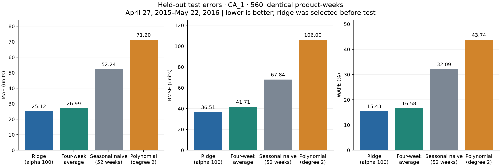
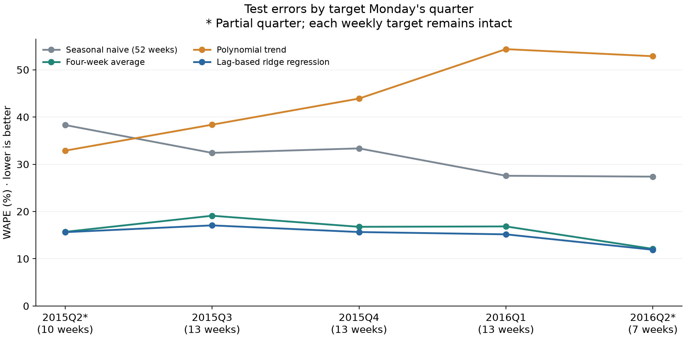

# Part 4 — Evaluate forecasts

All four methods predict the same **560 product-weeks**: ten CA_1 products over 56 weeks, **April 27, 2015–May 22, 2016**. The resulting table contains **2,240 forecasts**. MAE and RMSE measure units per product-week. WAPE is 100 × total absolute error / total observed units; it is not a mean of individual percentage errors. Positive bias in the CSVs means overprediction.

## Fixed evaluation protocol

Part 3 selected ridge by validation MAE, polynomial degree 2, and ridge alpha 100. All fitted coefficients and preprocessing stay fixed at the March 1, 2015 training cutoff. There is no refit on validation or test, and no model reselection using test results. Each weekly forecast may use earlier test sales after they become observed history; this is a rolling one-week-ahead evaluation. Negative raw predictions are retained and clipped to zero for scoring; forecasts remain fractional.

The proposal's 10% error-reduction objective is operationalized as at least 10% lower **overall MAE and RMSE** than seasonal naive. Each metric is also reported separately. The primary conclusion concerns the validation-selected ridge model. Product/quarter attainment describes variation and is not a requirement that every subgroup pass.

## Overall results

| Method | MAE | RMSE | WAPE | MAE reduction | RMSE reduction | Both ≥10%? |
|---|---:|---:|---:|---:|---:|:---:|
| Lag-based ridge regression (selected on validation) | 25.12 | 36.51 | 15.43% | 51.91% | 46.18% | Yes |
| Four-week average | 26.99 | 41.71 | 16.58% | 48.34% | 38.52% | Yes |
| Seasonal naive (52 weeks) | 52.24 | 67.84 | 32.09% | 0.00% | 0.00% | No |
| Polynomial trend | 71.20 | 106.00 | 43.74% | -36.31% | -56.24% | No |

The validation-selected **Lag-based ridge regression** **meets** the overall 10% improvement target. Relative to seasonal naive, its MAE reduction is **51.91%** and its RMSE reduction is **46.18%**. The operational rule fixed before scoring requires both reductions to be at least 10%. Negative reductions indicate higher error.

The lowest observed test MAE belongs to **Lag-based ridge regression** (25.12); the lowest observed test RMSE belongs to **Lag-based ridge regression** (36.51). This is a descriptive comparison of fixed methods and does not change the validation-selected model. WAPE and MAE have the same ranking on this common test set because their denominator is fixed.

## Results by product

Each product contributes 56 test observations to each method. The table below shows the validation-selected ridge model; `test_metrics_by_product.csv` contains MAE, RMSE, WAPE, and matching seasonal-baseline comparisons for all four methods. Ridge meets both 10% thresholds for **10/10 products**.

| Product | Observations | MAE | RMSE | WAPE | MAE reduction | RMSE reduction | Both ≥10%? |
|---|---:|---:|---:|---:|---:|---:|:---:|
| FOODS_3_586 | 56 | 27.41 | 36.69 | 9.06% | 50.35% | 45.61% | Yes |
| FOODS_3_252 | 56 | 30.10 | 38.57 | 11.11% | 37.64% | 36.02% | Yes |
| FOODS_3_714 | 56 | 19.22 | 25.09 | 12.12% | 55.05% | 50.21% | Yes |
| FOODS_3_607 | 56 | 19.27 | 24.63 | 23.02% | 73.95% | 72.68% | Yes |
| FOODS_3_064 | 56 | 23.48 | 30.79 | 11.81% | 53.91% | 51.76% | Yes |
| FOODS_3_555 | 56 | 12.76 | 16.83 | 9.99% | 44.29% | 40.20% | Yes |
| FOODS_2_197 | 56 | 17.39 | 22.45 | 14.47% | 52.03% | 50.11% | Yes |
| FOODS_3_739 | 56 | 29.57 | 43.97 | 27.20% | 60.39% | 50.81% | Yes |
| FOODS_3_501 | 56 | 52.90 | 70.41 | 38.97% | 38.90% | 32.04% | Yes |
| FOODS_3_099 | 56 | 19.09 | 25.20 | 15.77% | 38.08% | 36.25% | Yes |

## Results by quarter

Assign each complete weekly target to the calendar quarter of its Monday. There are **10, 13, 13, 13, and 7 weeks** in the five test-quarter groups. **2015Q2 and 2016Q2 are partial quarters** (marked *), so they are not complete-quarter summaries. The final week assigned to a quarter can end in the next quarter. `test_quarter_coverage.csv` records the exact bounds and counts.

The following table shows ridge. `test_metrics_by_quarter.csv` compares all four methods, and `test_metrics_by_product_quarter.csv` also breaks each quarter down by product. Ridge meets both 10% thresholds for **5/5 quarter groups**, including the partial groups.

| Target quarter | Observations | MAE | RMSE | WAPE | MAE reduction | RMSE reduction | Both ≥10%? |
|---|---:|---:|---:|---:|---:|---:|:---:|
| 2015Q2* | 100 | 27.49 | 38.77 | 15.63% | 59.20% | 55.32% | Yes |
| 2015Q3 | 130 | 30.06 | 44.52 | 17.06% | 47.36% | 40.51% | Yes |
| 2015Q4 | 130 | 23.83 | 36.14 | 15.66% | 53.07% | 42.49% | Yes |
| 2016Q1 | 130 | 22.75 | 30.74 | 15.17% | 44.98% | 41.06% | Yes |
| 2016Q2* | 70 | 19.33 | 25.63 | 11.90% | 56.53% | 55.26% | Yes |

## Interpretation and remaining work

These descriptive results apply to ten frequently sold foods at one store. Observed sales are a proxy for demand and cannot reveal stockouts or unmet demand. The test observations share time and product structure, so they are not independent replicates; no statistical significance claim is made. Pooled errors give more influence to larger-volume products. Product tables and quarter tables should accompany the overall score. RMSE and WAPE must be recomputed from pooled error sums, rather than averaged across groups.

Before test scoring, the notebook saves 80% and 95% interval calibration widths for each method using only its 80 validation absolute residuals. The width is the sorted residual at 1-based rank `ceil((n+1)*coverage)` (65 and 77 here). Part 5 will construct `[max(0, prediction-width), prediction+width]`, evaluate held-out coverage, and plot actual versus predicted sales with intervals. The choices are frozen in `pretest_protocol.json` and `pretest_interval_calibration.csv`; test errors are never used to choose the widths. Serial dependence, differing product scales, and model selection on the same validation window mean no exact coverage guarantee is claimed. The order-statistic calibration follows [Angelopoulos and Bates](https://arxiv.org/abs/2107.07511), with these limitations explicitly retained.

**Part 5 remains unfinished:** test prediction intervals, coverage, and actual-versus-predicted plots with uncertainty. **Part 6 remains unfinished:** assemble and verify the final submission report. The figures here compare point-forecast errors.

## Reproduce and audit

Run [the Milestone 2 notebook](../../../M5_Milestone_2_Demand_Forecasting.ipynb) top to bottom in the project Python 3.15 kernel. Part 4 is Section 5. The same run regenerates the dataset, validation results, and this evaluation. **11 evaluation checks pass**, alongside the existing 19 data-preparation and 10 model checks.

- `test_predictions.csv`: every test key, actual value, raw/scored forecast, and individual error.
- `test_metrics.csv`, `test_target_assessment.csv`: overall scores, relative reductions, and target attainment.
- `test_metrics_by_product.csv`, `test_metrics_by_quarter.csv`, `test_metrics_by_product_quarter.csv`: all model comparisons by subgroup.
- `test_quarter_coverage.csv`: observed weeks and partial-quarter flags.
- `pretest_protocol.json`, `frozen_model_selection.json`, `frozen_fitted_models.json`: choices and original fitted states preserved before scoring.
- `pretest_interval_calibration.csv`: validation-only residual widths for the later uncertainty analysis.
- `evaluation_checks.csv`, `evaluation_metadata.json`: verification, definitions, provenance, and result hashes.
- `figures/test_model_comparison.png`, `figures/test_WAPE_by_quarter.png`: overall and quarterly error comparisons.
